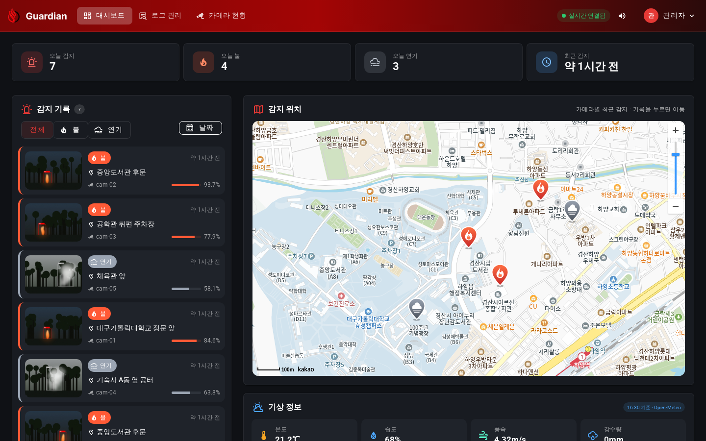
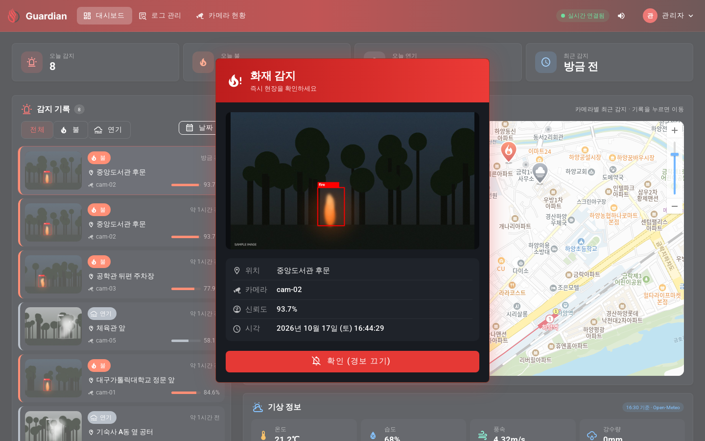
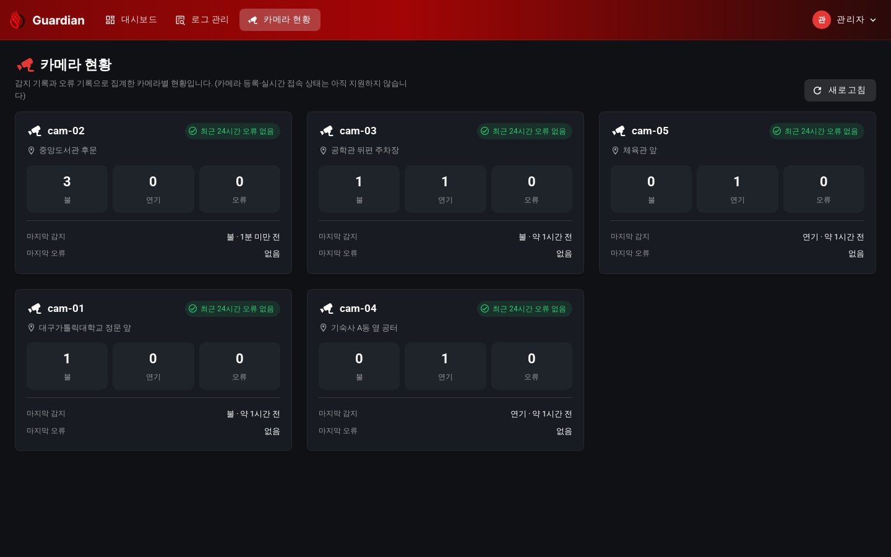
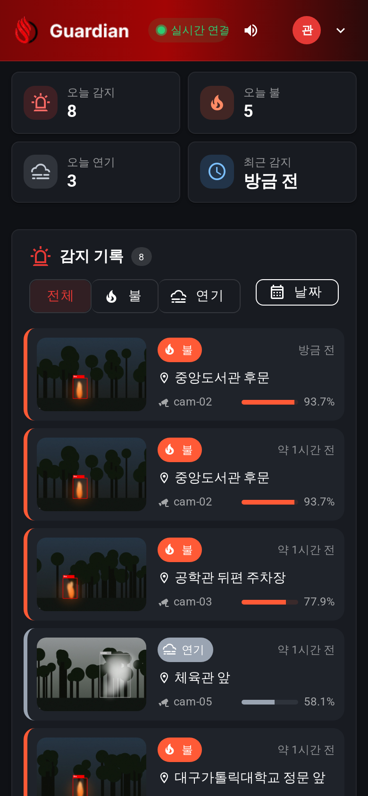
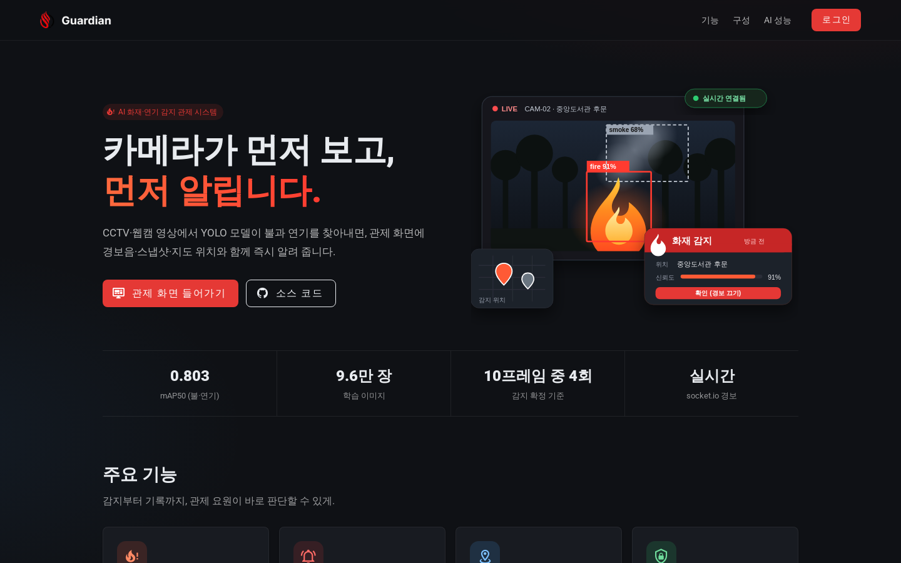
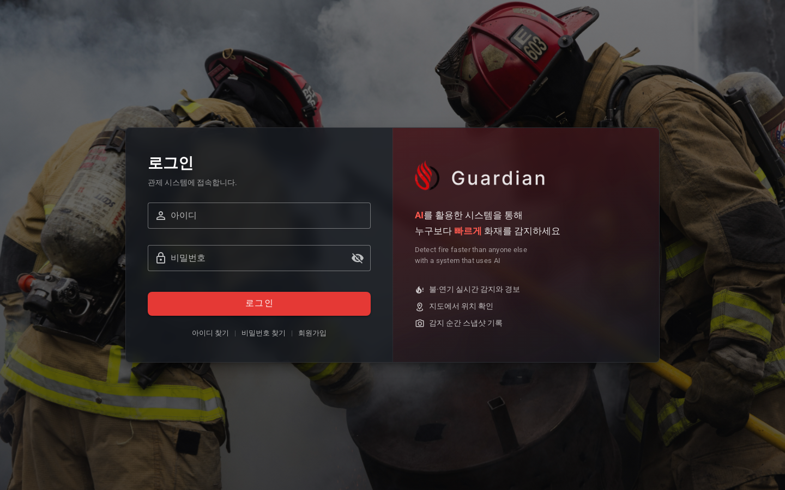
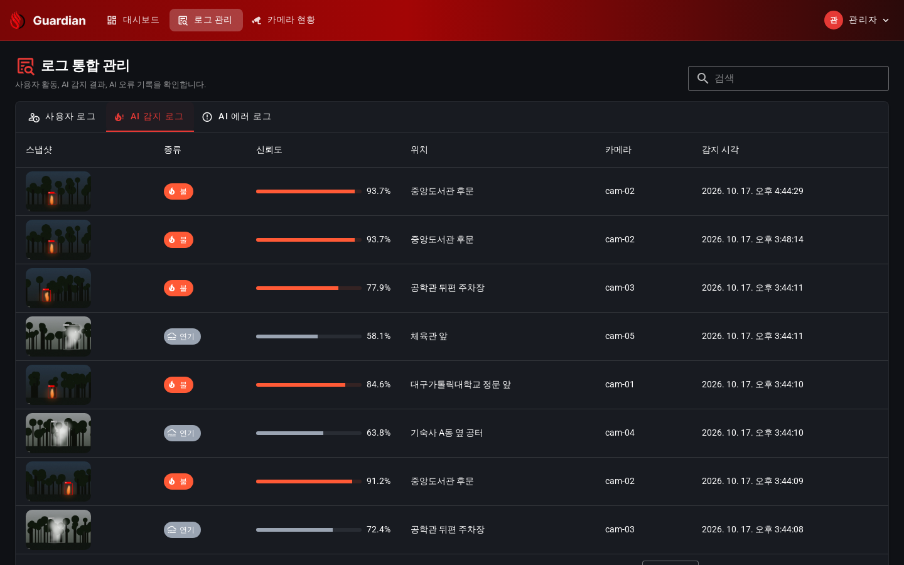
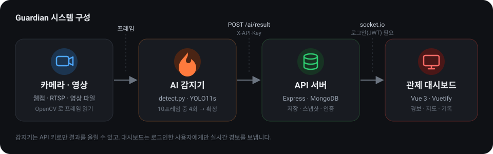
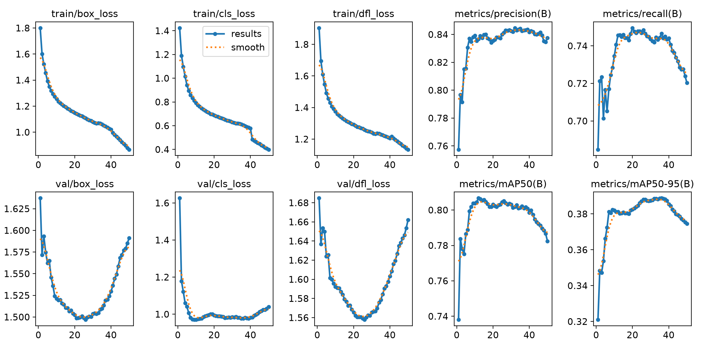
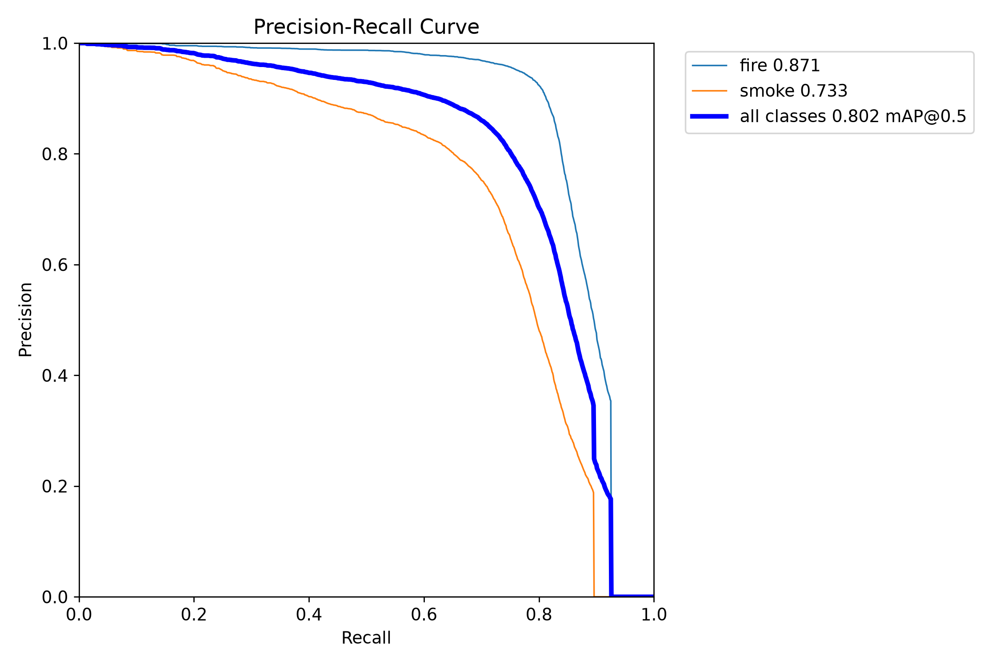

# Guardian — AI 화재·연기 감지 관제 시스템

카메라 영상에서 YOLO 모델로 **불·연기**를 찾아내고, 웹 대시보드에 **실시간 경보(팝업·경보음·스냅샷·지도 마커)**를 띄우는 시스템입니다.
2025년 캡스톤 프로젝트(감지 결과 수신·표시 웹)를 바탕으로, 2026년 10월에 **AI 모델 학습·감지 코드를 직접 붙이고 보안·화면을 다시 만든 v2** 입니다.



| 실시간 경보 | 카메라 현황 | 모바일 |
|---|---|---|
|  |  |  |

| 소개 페이지 | 로그인 | 로그 관리 |
|---|---|---|
|  |  |  |

> 캡처의 스냅샷은 시험용으로 직접 만든 합성 이미지입니다(`SAMPLE IMAGE` 표시). 지도는 카카오맵입니다.

## 주요 기능

- **실시간 감지**: 웹캠·RTSP·영상 파일에서 YOLO11s 로 불·연기 탐지. 최근 10프레임 중 4번 이상 잡혀야 알림(깜빡이는 오탐 방지), 같은 종류는 60초 쿨다운
- **관제 대시보드**: 감지 기록(썸네일·신뢰도·시간), 불/연기·날짜 필터, 지도 마커, 경보 팝업과 경보음(켜기/끄기), 오늘의 감지 요약, 실제 기상 정보
- **공공 CCTV 연동**: 국가교통정보센터(ITS) 공공 CCTV 를 지도에 표시하고 실시간 영상(HLS) 재생. 버튼 하나로 그 CCTV 를 AI 감지기가 감시하는 명령을 만들어 주고, 불·연기가 나면 경보 창에서 그 장소의 실시간 영상을 바로 볼 수 있음
- **카메라 현황**: 감지·오류 기록으로 카메라별 불·연기·오류 횟수와 마지막 감지·오류를 집계
- **소개 페이지**: 로그인 없이 프로젝트 기능·구성·AI 성능을 보여 주는 첫 화면
- **운영 안정성**: 카메라·모델 오류를 서버에 보고, 서버가 끊기면 감지 결과를 보관했다가 재전송
- **계정·보안**: JWT 로그인, 이메일 인증코드로 비밀번호 재설정, scrypt 해시, 감지기 전용 API 키, 요청 횟수 제한

## 구성



| 영역 | 기술 |
|---|---|
| AI | Python, Ultralytics YOLO11s, PyTorch(CUDA), OpenCV |
| 백엔드 | Node.js, Express 4, Mongoose 8(MongoDB), socket.io, JWT, nodemailer |
| 프런트엔드 | Vue 3, Vuetify 3, Vite, Axios, date-fns, 카카오맵 SDK |

| 폴더 | 내용 |
|---|---|
| `ai/` | 데이터 변환(`convert_aihub.py`), 학습(`train.py`), 실시간 감지(`detect.py`), 평가(`evaluate/`) |
| `backend-main/` | API 서버 (포트 10111), MongoDB 저장, 실시간 전송 |
| `frontend-main/` | 관제 대시보드 (포트 3000) |
| `docs/` | 캡처, 학습 결과 그래프 |

## AI 모델 결과

AI Hub 「화재 발생 예측 영상」(야외 화재·연기 영상 프레임)으로 YOLO11s 를 미세조정했습니다.
학습 9.6만 장 / 검증 1.6만 장(같은 영상의 프레임이 학습과 검증에 섞이지 않게 영상 단위로 분리), RTX 5060, 50 epoch ≈ 12시간.

| | mAP50 | mAP50-95 |
|---|---|---|
| 전체 | 0.803 | 0.389 |
| 불 | 0.872 | 0.435 |
| 연기 | 0.733 | 0.342 |

| 학습 곡선 | 정밀도-재현율 곡선 |
|---|---|
|  |  |

- **과적합 경향**: 검증 손실은 25 epoch 부근부터, mAP 는 30번대 epoch 이후 오히려 떨어집니다(mAP50 0.803 → 0.782). 그래서 마지막이 아니라 **가장 성능이 좋았던 epoch 의 가중치**(`best.pt`)를 채택했습니다.
- **연기가 더 어렵습니다**: 형태가 흐릿해 불보다 점수가 낮고, 혼동 행렬([그림](docs/training/confusion_matrix_normalized.png))에서도 오탐의 대부분이 연기 쪽입니다.

**mAP 외에 실제 알림 기준으로도 평가했습니다** (`ai/evaluate/`)

- `eval_false_alarm.py`: 학습에 쓰지 않은 사진 2,000장씩으로 이미지 단위 감지율·오탐률. 현재 설정(불 0.5 / 연기 0.45)에서 불·연기 사진의 80.7% 를 찾고, 불·연기가 없는 평범한 사진의 오탐은 1.9% 였습니다.
- `eval_video_sim.py`: 영상 순서대로 모델을 돌리고 `detect.py` 의 확정 로직(10프레임 중 4회)을 그대로 적용해, 설정별 첫 알림까지의 지연과 오경보를 비교합니다. 연기 신뢰도 기준을 0.45 → 0.25 로 낮춰도 연기를 잡는 영상 수는 늘지 않아(7개 중 5개) 기본값을 유지했습니다.

## 데이터·자료 출처

- 학습 데이터는 [AI Hub](https://www.aihub.or.kr) 「화재 발생 예측 영상」입니다. 데이터의 이용 조건은 AI Hub 이용약관을 따릅니다.
- **원본 이미지·라벨은 이 저장소에 포함하지 않았습니다.** 문서의 학습 결과 그림도 사진이 없는 그래프만 사용했고, 대시보드 캡처는 합성 이미지입니다.
- 학습된 가중치(`ai/weights/guardian_best.pt`, 19MB)는 바로 실행해 볼 수 있도록 포함했습니다. 직접 학습하려면 AI Hub 에서 데이터를 받아 아래 4장을 따라 하세요.
- 로그인 배경 사진: [Unsplash](https://unsplash.com/photos/In6CM5iF1P8) (matt-c, Unsplash License)
- 일러스트·구성도·지도 마커·파비콘: 이 프로젝트에서 직접 만든 SVG (`frontend-main/src/assets/illust/`)
- 경보음: 음원 파일 없이 브라우저 Web Audio API 로 합성 (`frontend-main/src/utils/alarm.js`)
- 날씨: [Open-Meteo](https://open-meteo.com) (무료, 키 불필요) · 지도: 카카오맵 JavaScript SDK

---

## 1. 준비물

- **Node.js 18 이상**, **MongoDB** (로컬 `localhost:27017` 또는 MongoDB Atlas)
- **Python 3.10~3.12**, **NVIDIA GPU + 최신 드라이버** (학습용)

## 2. 백엔드 실행

```bash
cd backend-main
rm -rf node_modules            # 예전 zip 에 들어 있던 node_modules 는 버전이 달라 꼭 지우고 새로 설치
npm install
cp .env.example .env           # Windows: copy .env.example .env
```

`.env` 에서 최소한 아래 두 값을 채웁니다. 각각 다음 명령으로 무작위 값을 만들어 붙여 넣으세요.

```bash
node -e "console.log(require('crypto').randomBytes(48).toString('hex'))"   # → JWT_SECRET
node -e "console.log(require('crypto').randomBytes(24).toString('hex'))"   # → AI_API_KEY
```

```bash
npm start        # 또는 개발 중에는 npm run dev (파일 바꾸면 자동 재시작)
```

**인증코드 메일 (아이디 찾기·비밀번호 재설정)**
`SMTP_USER`, `SMTP_PASS` 를 비워 두면 메일 대신 **서버 콘솔에 인증코드가 출력**됩니다(개발·시연용).
실제로 메일을 보내려면 Gmail 기준: 구글 계정 → 보안 → 2단계 인증 켜기 → **앱 비밀번호** 발급 → `SMTP_USER=본인@gmail.com`, `SMTP_PASS=앱 비밀번호 16자리`.

## 3. 프런트엔드 실행

```bash
cd frontend-main
npm install
cp .env.example .env
npm run dev      # http://localhost:3000
```

- `VITE_KAKAO_MAP_KEY`: [카카오 개발자](https://developers.kakao.com) → 내 애플리케이션 → **JavaScript 키**. 플랫폼 → Web 에 `http://localhost:3000` 등록.
  > 예전 코드에 들어 있던 키는 이미 공개됐으니 **새로 발급**하거나 허용 도메인을 제한하세요.
- `/signup` 에서 계정을 만들고 로그인합니다. (비밀번호는 영문+숫자 8자 이상)

## 4. YOLO 모델 만들기 (내 PC, NVIDIA GPU)

### 4-1. 파이썬 환경

```bash
cd ai
python -m venv .venv
.venv\Scripts\activate           # macOS/Linux: source .venv/bin/activate
```

**PyTorch GPU 설치** — [pytorch.org](https://pytorch.org/get-started/locally/) 에서 OS·pip·CUDA 를 고르면 나오는 명령을 그대로 실행합니다. 예:

```bash
pip install torch torchvision --index-url https://download.pytorch.org/whl/cu124
pip install -r requirements.txt
python -c "import torch; print(torch.cuda.is_available(), torch.cuda.get_device_name(0))"   # True 가 나와야 함
```

### 4-2. 데이터 받기

[AI Hub](https://www.aihub.or.kr) 에서 화재·산불 영상/이미지 데이터를 받습니다 (예: 「화재 발생 예측 영상」, 로그인 + 활용 신청 필요).
보통 **원천데이터(jpg)** 와 **라벨링데이터(json)** 폴더로 나뉘어 있습니다. 용량이 크면 Training 쪽 일부만 받아 시작해도 됩니다.

### 4-3. 라벨 확인 → 클래스 연결 → 변환

```bash
# ① 라벨에 어떤 클래스 코드가 있는지 확인
python convert_aihub.py --labels D:/aihub/라벨링데이터 --inspect
```

AI Hub 라벨은 클래스가 `"01"`~`"10"` 같은 **코드**입니다. 데이터와 함께 받은 **가이드 PDF** 에서 코드 뜻을 확인하고
`class_map.yaml` 에 `fire` / `smoke` / `ignore` 로 적습니다.
(「화재 발생 예측 영상」은 실제 이미지에 박스를 겹쳐 확인해 **01·02·03 = 연기, 04 = 불꽃, 05~10 = 헷갈리는 장면(ignore)** 으로 이미 설정해 두었습니다. 다른 데이터를 쓸 때만 고치면 됩니다.) 구름·안개·조명·햇빛 같은 **헷갈리는 장면은 `ignore`** 로 두면
"불·연기 아님" 예시로 학습에 들어가 오탐이 줄어듭니다.

```bash
# ② YOLO 형식으로 변환 (train/val 자동 분리)
python convert_aihub.py --images D:/aihub/원천데이터 --labels D:/aihub/라벨링데이터 --out datasets/guardian
```

- 같은 영상에서 나온 프레임은 **train/val 한쪽으로만** 들어가게 묶습니다 (안 그러면 검증 점수가 실제보다 높게 나옴).
  파일 이름 끝의 숫자를 프레임 번호로 보는데, 이름 규칙이 다르면 `--group-regex` 로 바꾸세요.
- bbox 가 `[x, y, 너비, 높이]` 형식인 데이터라면 `--bbox-format xywh`.
- COCO 형식(JSON 하나에 images/annotations/categories) 데이터도 같은 명령으로 됩니다.

### 4-4. 학습

```bash
python train.py --data datasets/guardian/data.yaml                 # 기본 yolo11s, 100 epoch
python train.py --data datasets/guardian/data.yaml --model yolo11m.pt --epochs 150   # GPU 여유 있으면
```

- 끝나면 `weights/guardian_best.pt` 가 생기고 클래스별 mAP 가 출력됩니다. 그래프와 예측 예시는 `runs/detect/runs/guardian*/` 에 있습니다(ultralytics 버전에 따라 `runs/guardian*/` 일 수 있음).
- GPU 메모리 부족 → `--batch 8` / Windows 에서 DataLoader 오류 → `--workers 0`
- 중간에 끊겼으면 `python train.py --data ... --model runs/guardian/weights/last.pt --resume`

학습 결과와 해석은 위 "AI 모델 결과" 장에 있습니다. 학습된 가중치 `ai/weights/guardian_best.pt` 가 저장소에 들어 있어서, 다른 PC에서는 학습 없이 바로 감지를 실행할 수 있습니다.

### 4-5. 실시간 감지 실행

```bash
copy config.example.yaml config.yaml    # macOS/Linux: cp
```

`config.yaml` 에서 `server.api_key` 를 백엔드 `.env` 의 `AI_API_KEY` 와 **똑같이** 맞추고, 카메라·위치·좌표를 적습니다.

```bash
python detect.py --test-alert          # ① 모델 없이 서버 연결만 시험 → 대시보드에 시험 알림이 떠야 함
python detect.py --source test.mp4     # ② 화재 영상으로 시험
python detect.py                       # ③ config 의 카메라(웹캠 0 / RTSP)로 실행
```

**오탐·미탐 조절** (`config.yaml` 의 `detection`)
| 증상 | 조절 |
|---|---|
| 노을·조명에 자꾸 알림 | `conf.fire` 올리기 (0.5 → 0.6), `confirm_hits` 올리기 |
| 작은 불을 놓침 | `conf` 내리기, `min_box_area_ratio` 내리기 |
| 같은 불로 알림이 너무 자주 | `cooldown_sec` 올리기 |
| CPU 라서 느림 | `frame_stride: 3`, `model.device: cpu` |

### 4-6. 다른 PC(노트북·웹캠)에서 실행하기

학습은 필요 없고, 이 저장소 + 가중치만 있으면 됩니다. 한 PC에서 서버 3개(MongoDB·백엔드·프런트)와 감지기를 모두 돌리는 경우입니다.

```bash
git clone <이 저장소 주소> Guardian && cd Guardian
# 1) 백엔드: 2장 그대로 (npm install → .env 만들기 → npm start)   MongoDB 가 필요합니다
# 2) 프런트: 3장 그대로 (npm install → .env 만들기 → npm run dev)
# 3) 감지기
cd ai
python -m venv .venv
.venv\Scripts\activate                       # macOS/Linux: source .venv/bin/activate
pip install torch torchvision                 # NVIDIA GPU 가 없으면 이것만으로 CPU 로 동작
pip install -r requirements.txt
copy config.example.yaml config.yaml          # macOS/Linux: cp
```

`config.yaml` 에서 바꿀 것

- `server.api_key`: 백엔드 `.env` 의 `AI_API_KEY` 와 똑같이
- `camera.source: 0` (내장 웹캠), `camera.location`·`latitude`·`longitude`: 설치 위치
- GPU 가 없으면 `model.device: cpu`, `detection.frame_stride: 3` (CPU 는 느리므로 3프레임마다 한 번 추론)

```bash
python detect.py --test-alert      # 서버 연결 확인 (대시보드에 시험 알림, 연기는 --test-alert smoke)
python detect.py                   # 웹캠으로 실시간 감지 (창에서 q 로 종료)
```

화면 창 없이 돌리려면 `--no-show`. 웹캠이 안 열리면 `camera.source` 를 1, 2 로 바꿔 보세요.

### 4-7. 공공 CCTV 연동 (국가교통정보센터 ITS)

원래 기획은 **직접 설치했거나 공공기관이 가진 CCTV 가 비추는 산·도로에서 불이 나면 먼저 알리는 것**이었습니다.
CCTV 를 살 예산이 없어 캡스톤 때는 준비한 영상을 트는 방식으로 대신했는데, v2 에서는 공공 CCTV 를 직접 연결합니다.

1. [국가교통정보센터](https://www.its.go.kr) 회원가입 → 공공데이터 개방 → 오픈API 에서 **CCTV 정보** 인증키 발급
2. `backend-main/.env` 에 `ITS_API_KEY=발급받은 키` 를 넣고 백엔드 재시작
   (`ITS_API_KEY=test` 로 두면 ITS 가 주는 시험용 목록이 지도에 표시되지만 영상은 재생되지 않습니다)
3. 대시보드 지도 오른쪽 위 **공공 CCTV** 버튼 → 지도 범위의 CCTV 가 파란 아이콘으로 표시 → 누르면 실시간 영상
4. 영상 창의 **"이 CCTV 를 AI 로 감시하기"** 명령을 복사해 `ai` 폴더에서 실행하면, 감지기가 그 영상을 분석합니다.
   ```bash
   python detect.py --source "<CCTV 영상 주소>" --camera-id "cctv-…" --location "<CCTV 이름>" --lat 37.4 --lng 127.1 --no-show
   ```
   불·연기가 확인되면 그 CCTV 위치로 경보가 오고, 경보 창의 **실시간 영상 보기** 로 현장 영상을 바로 확인합니다.
   (`--source` 가 http(s) 주소일 때만 영상 주소를 서버로 보냅니다. 아이디·비밀번호가 들어갈 수 있는 rtsp 주소는 보내지 않습니다.)

알아 둘 점

- ITS 는 **도로(국도·고속도로) CCTV** 입니다. 산림청 산불 감시 CCTV 는 공개 API 가 없어 연동하지 못했습니다. 다만 같은 방식으로 http(s) 영상 주소만 있으면 어떤 CCTV 든 `--source` 로 감시할 수 있습니다.
- ITS 영상 주소에는 유효 시간이 있어, 오래 감시하려면 주소를 다시 받아야 할 수 있습니다.
- 공공 CCTV 영상은 H.264 라서 Chrome·Edge·Safari 에서 재생됩니다. 사이트를 https 로 배포하면 http 영상은 브라우저가 막을 수 있습니다.
- 이용 조건은 국가교통정보센터 오픈API 이용약관을 따릅니다.

## 5. API 요약

| 경로 | 인증 | 설명 |
|---|---|---|
| `POST /login`, `/register` | - | 로그인(JWT 발급), 회원가입 |
| `POST /findID` | - | 이름+이메일 → **아이디를 메일로** 발송 |
| `POST /password/code` → `/password/reset` | - | 인증코드 메일 발송 → 코드+새 비밀번호로 변경 (10분 유효, 5회 틀리면 무효) |
| `GET /ai/result/all`, `/ai/error/all`, `/log/all` | JWT | 감지·오류·사용자 로그 조회 (`?limit=`, `?type=불`) |
| `POST /ai/result` | **X-API-Key** | `{type:"불"\|"연기", confidence:0~100, location, cameraId?, latitude?, longitude?, bbox?, image?(base64 jpg), streamUrl?(http(s) 실시간 영상)}` |
| `GET /cctv/public?minX&maxX&minY&maxY` | JWT | 지도 범위의 공공 CCTV 목록(ITS). 서버 `.env` 의 `ITS_API_KEY` 필요 |
| `POST /ai/error` | **X-API-Key** | `{errorType, message?, location?, cameraId?, rawData?}` |
| socket.io `aiResult`, `aiError` | JWT (`auth.token`) | 대시보드 실시간 알림 |

## 6. 이번에 고친 것 (2026-10)

**보안**
- 감지 결과 업로드(`/ai/*` POST)에 **API 키**, 조회 API와 실시간 소켓에 **로그인 토큰** 필수
- 비밀번호 재설정: ID+이메일만으로 바뀌던 것을 **이메일 인증코드** 방식으로 / 아이디 찾기는 화면 대신 **메일로** 전달
- 비밀번호 해시를 SHA-512 1회 → **scrypt** 로 (예전 계정은 로그인할 때 자동 변환) / 비밀번호 규칙(영문+숫자 8자 이상)
- 로그인·인증코드 **횟수 제한**, 로그인 실패 메시지로 계정 존재 여부가 드러나지 않게
- JWT 비밀키·Kakao 키·서버 주소를 코드에서 빼서 `.env` 로, CORS 를 프런트 주소만 허용
- 프런트 **로그인 가드** (로그인 안 하면 대시보드·로그 화면 접근 불가, 토큰 만료 시 로그인 화면으로)
- 사용자 로그의 `userId` 를 요청 본문이 아니라 토큰에서 가져오게 (남의 이름으로 기록 불가)

**버그·기능**
- 회원가입 화면의 **전역 CSS 가 대시보드까지 덮어써서** 스크롤·배경이 깨지던 문제
- 대시보드를 나갔다 들어오면 소켓이 중복 연결돼 **알림이 두 번씩** 뜨던 문제
- 로그인·회원가입 등 **사용자 행동이 실제로 로그에 쌓이도록** (예전엔 아무도 `/log/save` 를 호출하지 않아 비어 있었음)
- 감지 **스냅샷 이미지**, 카메라 ID, **지도 마커**(좌표가 있으면), 실시간 연결 상태, 로그아웃 버튼
- 연기 카드가 검은 배경에 검은 글씨라 안 보이던 문제, Vuetify 2 문법(`dense`, `outlined`) 정리
- 입력값 검증 (종류·신뢰도 범위·이미지 형식/크기), 잘못된 JSON·없는 경로에 대한 응답

**화면(UI)**
- 대시보드를 관제 화면으로 다시 만듦: 요약 카드, 감지 기록(썸네일·신뢰도·상대 시간), 불/연기 필터, 지도 마커(불·연기 별도 아이콘), 경보 팝업
- 이모지를 아이콘 이미지로 교체(PC 글꼴에 따라 안 보이던 문제), 스냅샷 파일이 없으면 안내 이미지 표시
- 로그 화면 검색·정렬, 회원가입·아이디 찾기·비밀번호 재설정을 로그인 화면과 같은 디자인으로 통일, 모바일 폭 대응

**정리**
- 죽은 코드 삭제: passport 설정, `auth.controller.js`, `routes_config.js`, 빈 소켓 컨트롤러, 테스트용 HTML, `FireAlert.vue`, `newLogin.vue`, 중복 `AIResultTable.vue`, `vuetify-project/`
- 백엔드 패키지 39개 → 6개 (안 쓰던 zeromq, rtsp, sharp 등 제거), socket.io 를 프런트와 같은 4.x 로, mongoose 8.x
- `tools/add_user.js` 를 실제 모델(이메일·이름 필수)에 맞게: `npm run add-user -- 아이디 비밀번호 이메일 이름`

**화면 추가**: 기상 정보를 실제 값으로 연동(Open-Meteo, 키 불필요, 10분마다 갱신), 쓸 수 없던 "CCTV 관리·사용자 관리" 메뉴를 "카메라 현황" 화면(감지·오류 기록으로 카메라별 집계)으로 교체, 로그인 화면을 대시보드와 같은 디자인으로 통일하고 모바일 폭 대응.

**포트폴리오 보강**: 로그인 없이 보는 소개 페이지(직접 만든 히어로 일러스트·구성도), 404 화면, SVG 파비콘, 출처를 알 수 없던 경보음 mp3 를 Web Audio 합성음으로 교체하고 경보음 켜기/끄기 버튼 추가, 쓰지 않는 이미지 6개 삭제.

**공공 CCTV**: ITS 공공 CCTV 지도 표시·실시간 영상(hls.js), 감지기의 http(s) 영상 감시(`--source`, `--camera-id`, `--location`, `--lat`, `--lng`), 경보 창의 실시간 영상 보기, 시험 알림 이미지를 불·연기 합성 장면으로 교체.

**아직 남은 것**: 카메라 등록·실시간 접속 상태 확인, 사용자 관리 화면.

## 7. 알려진 한계

- 감지 스냅샷(`/snapshots`)은 로그인 없이 URL만 알면 열립니다. 파일명이 무작위라는 점에만 의존합니다.
- JWT 를 `localStorage` 에 저장하며, 서버 쪽에서 토큰을 무효화하는 기능(로그아웃 시 폐기, refresh 토큰)은 없습니다.
- 사용자 권한 구분이 없습니다. 가입한 사용자는 모두 전체 로그를 볼 수 있고, `ALLOW_SIGNUP=false` 로 가입을 막을 수 있습니다.
- 요청 횟수 제한은 서버 메모리 기준입니다. 재시작하면 초기화되고, 프록시 뒤에서는 `trust proxy` 설정이 필요합니다.
- 메일(SMTP)을 설정하지 않으면 인증코드가 서버 콘솔에 출력됩니다. 운영에서는 반드시 SMTP 를 설정하세요.
- 학습 데이터는 야외 영상(산불·모닥불 등)뿐입니다. 실내·야간·CCTV 화면에서의 성능은 확인되지 않았습니다.
- 유사씬(구름·안개 등) 오탐 측정은 학습에 쓰인 영상과 같은 영상의 사진이라 실제보다 좋게 나왔을 수 있습니다. 새로운 영상으로 다시 확인해야 합니다.
- 연기는 불보다 놓치는 경우가 많습니다(검증 연기 mAP50 0.73, 불 0.87). 옅은 연기는 신뢰도가 낮아 알림으로 이어지지 않을 수 있습니다.
- 자동 테스트는 감지 확정 로직(`ai/test_detect.py`)뿐입니다. `cd ai && python -m unittest test_detect -v`

## 8. 프로젝트 이력

- **2025-04**: 캡스톤 프로젝트로 제작한 원본 (Vue 3 + Express 대시보드, 감지 결과 수신·표시).
- **2026-10 (v2)**: AI 도구(Claude)의 도움을 받아 YOLO 학습·감지 코드(`ai/`)를 추가하고, 위 6장의 보안·버그를 개선했습니다.
